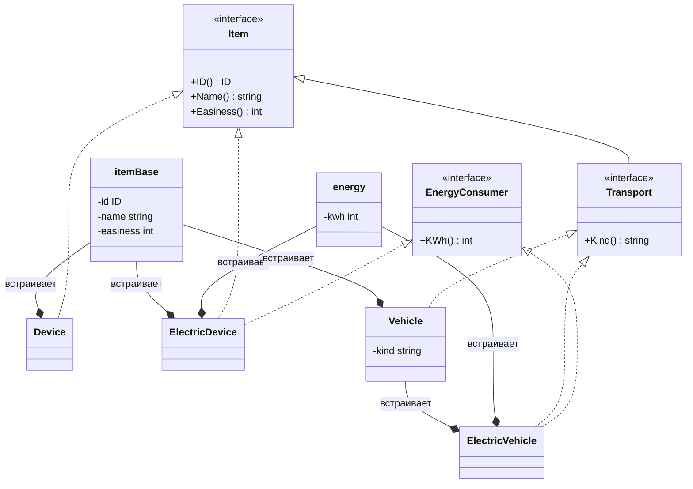
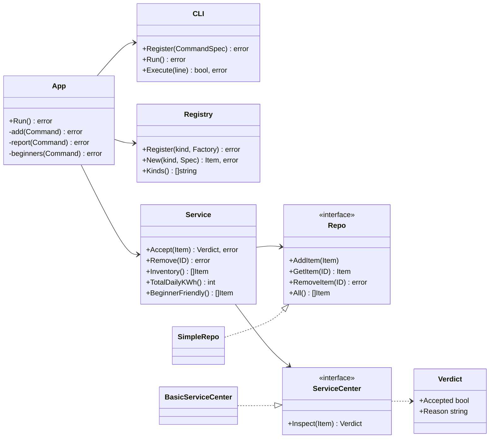

# ВышКат — учёт парка кикшеринга

Консольное приложение учёта парка «ВышКат»: приём техники и вещей на баланс через техосмотр, отчёты по числу единиц и суммарному энергопотреблению, список устройств для новичков, вывод инвентарных номеров.

## Запуск

Нужен Go 1.27+.

```sh
go run .                          # интерактивный режим, список команд — help
printf 'demo\nexit\n' | go run .  # прогон всех сценариев без ручного ввода
go test -cover ./...              # тесты с покрытием по пакетам
```

### Команды

| Команда | Что делает |
|---|---|
| `add <вид> <номер> "<название>" [простота] [кВт·ч/сут]` | создать предмет и принять его в парк через техосмотр |
| `remove <номер>` | списать с баланса |
| `kinds` | виды, которые можно добавить |
| `inventory` | всё на балансе: номер, название, вид, простота, расход |
| `report` | число единиц (всего / транспорт / вещи), сколько подходит новичкам, суммарный расход |
| `energy` | суммарный суточный расход парка |
| `beginners` | устройства для новичков |
| `demo` | прогон всех сценариев (см. ниже) |
| `help`, `exit` | список команд, выход |

Названия с пробелами берутся в кавычки: `add scooter 1 "Ninebot Max G30" 7 1`.

Виды: `bike`, `scooter`, `ebike` — транспорт; `helmet`, `dock`, `charger` — вещи.

### Сценарий `demo`

Выполняет строки команд тем же путём, что и ручной ввод (`CLI.Execute`), и показывает все исходы:

- приём транспорта (с расходом и без) и вещей;
- отказ техосмотра — простота 12 вне диапазона;
- отказ учёта — занятый инвентарный номер;
- отказ фабрики — расход у вида, который не потребляет энергию;
- неизвестный вид;
- все отчёты, списание и повторный отчёт.

## Структура

```
main.go          точка сборки: DI-контейнер и регистрация видов
app/             команды CLI: связывают ввод пользователя с сервисом
ui/              универсальный консольный цикл и разбор строк, о домене не знает
service/         учёт парка: приём, отчёты; ничего не печатает
inspection/      техосмотр: интерфейс ServiceCenter и базовая реализация
repo/            хранилище в памяти
items/           доменная модель: интерфейсы, структуры, фабрики, реестр видов
```

Зависимости направлены в одну сторону: `main → app → service → inspection, items`; `app → ui`; `repo → items`. Пакет `service` не импортирует ни `repo`, ни `ui`.

## UML

### Доменная модель (`items`)

В Go нет наследования: стрелка «встраивает» — это встраивание структуры (composition), через которое внешняя структура получает методы встроенной. Пунктирная стрелка — реализация интерфейса, в Go неявная.



### Приложение



## Логика решений

### Модель

- **Всё на балансе — `Item`**: инвентарный номер, название, простота для новичка. По ТЗ простота есть у устройств, и мы трактуем «устройство» как любой предмет на балансе, поэтому простота входит в `Item`. Последствия разобраны в разделе про ISP.
- **`Transport` = `Item` + `Kind()`.** Транспорт отличается от вещей только тем, что у него есть вид проката.
- **`EnergyConsumer` — отдельный интерфейс.** Расход есть и у транспорта (самокат), и у вещей (зарядный шкаф), но не у всех (велосипед, шлем). Сервис и техосмотр узнают потребителя через type assertion.
- **Типы выделены по поведению, виды — по данным.** Признаков два: транспорт ли это и потребляет ли энергию. Отсюда четыре структуры: `Device`, `ElectricDevice`, `Vehicle`, `ElectricVehicle`. Самокат и электровелосипед ведут себя одинаково, поэтому это не разные Go-типы, а один `ElectricVehicle` с разным `kind`. Общие поля и методы собраны во встраиваемых `itemBase` и `energy`, без дублирования кода.
- **Фабрики и реестр.** `items.Registry` сопоставляет имя вида и фабрику `func(Spec) (Item, error)`. Для транспорта фабрика — замыкание по виду (`ElectricVehicleFactory(KindScooter)`), поэтому новый вид с уже существующим поведением добавляется одной строкой в `newRegistry` (`main.go`).

### Кто что проверяет

| Где | Что проверяет | Почему там |
|---|---|---|
| фабрика (`items.newBase`) | непустое название; нет расхода у вида, который не потребляет энергию | без этого объект нельзя корректно создать |
| `service.Accept` | инвентарный номер > 0 и не занят | это правила учёта: «номера обязательны» |
| `inspection.BasicServiceCenter` | простота 1–10, расход ≥ 0 | пригодность к эксплуатации — то, что решает техосмотр |

Отказ техосмотра — штатный исход, он возвращается в `Verdict`. Ошибка (`error`) означает, что предмет вообще нельзя учесть, и до техосмотра он не доходит.

### Правило «для новичков»

`service.BeginnerFriendly` возвращает все предметы на балансе с простотой ≥ `MinBeginnerEasiness` (6). Это соответствует функциональному требованию 4: «список **устройств** для новичков». Чтобы показывать только прокатную технику, достаточно добавить в фильтр проверку `it.(items.Transport)`: правило живёт в одном методе.

### Без вывода в доменных пакетах

`service` и `inspection` ничего не печатают: они возвращают данные (`Verdict`, срезы, числа). Текст формирует только `app`. Поэтому другой фронтенд (GUI, HTTP) использовал бы тот же `Service` без изменений, а тесты сервиса не зависят от консоли.

## SOLID

**S — единственная ответственность.**
- `ui.CLI` читает строки и вызывает команды и ничего не знает о парке.
- `ui.ParseLine` разбирает строку.
- `app` переводит команды в вызовы сервиса и форматирует вывод.
- `service.Service` реализует правила учёта, `inspection` — решение техосмотра, `repo` — хранение, `items.Registry` — создание предметов по виду.
- Пример выгоды: техосмотр раньше сам печатал результат, и отказ выводился дважды. После разделения он только возвращает `Verdict`.

**O — открытость для расширения.**
- Новый вид транспорта — одна строка регистрации фабрики в `main.go`. Если у вида своё поведение — ещё новая структура с фабрикой в `items`. `service`, `app`, `ui` не меняются.
- Новая команда регистрируется через `CLI.Register`, и `ui.CLI` при этом не правится.

**L — подстановка.**
- Любая реализация `items.Item` (четыре структуры и тестовые типы) обрабатывается сервисом, отчётами и `printItems` одинаково.
- Любая реализация `inspection.ServiceCenter` подставляется в `Service` без изменения его поведения: тесты используют заглушки, которые отклоняют всё, и сервис корректно не ставит предмет на баланс.

**I — разделение интерфейсов.**
- `EnergyConsumer` отделён от `Item`, поэтому велосипед и шлем не обязаны реализовывать `KWh()`.
- `Transport` отделён от `Item`, поэтому `Kind()` есть только у транспорта.
- `ServiceCenter` состоит из одного метода, `service.Repo` — из четырёх, которые сервис действительно вызывает.

**D — инверсия зависимостей.**
- `service.Service` зависит от интерфейсов `Repo` и `ServiceCenter`, а не от `SimpleRepo` и `BasicServiceCenter`.
- Интерфейс `Repo` объявлен в пакете-потребителе (`service`), как принято в Go, поэтому `service` не импортирует `repo`.
- Конкретные реализации выбирает DI-контейнер в `main.go`.

## DI-контейнер

Используется [`go.uber.org/dig`](https://github.com/uber-go/dig). В `buildContainer` (`main.go`) регистрируются конструкторы, и контейнер сам определяет порядок их вызова:

```go
{repo.NewSimpleRepo, []dig.ProvideOption{dig.As(new(service.Repo))}},
{inspection.NewBasicServiceCenter, []dig.ProvideOption{dig.As(new(inspection.ServiceCenter))}},
{service.NewService, nil},
```

`dig.As` привязывает реализацию к интерфейсу. Ввод и вывод передаются в `buildContainer` параметрами, поэтому тесты собирают тот же граф, что и `main`, но со своим вводом. Контейнер используется только в точке сборки: в другие пакеты он не передаётся, иначе это был бы service locator, а не DI.

## Тесты

Тесты лежат рядом с кодом по конвенции Go. Общее покрытие — **93%** (`go test -coverpkg=./... ./...`).

По пакетам:

| Пакет | Покрытие |
|---|---|
| `items` | 100% |
| `service` | 100% |
| `inspection` | 100% |
| `ui` | 95.9% |
| `repo` | 91.7% |
| `app` | 91.0% |

У `main` покрытие 52.6%: не покрыта сама функция `main`, а `buildContainer` и `newRegistry` покрыты.

## Обязательные вопросы

### Какой принцип SOLID применён наиболее явно и где?

**DIP** — в `service.Service`.
- Сервис принимает в конструкторе интерфейсы `service.Repo` и `inspection.ServiceCenter`.
- Интерфейс хранилища объявлен в самом `service`, поэтому пакет `service` не импортирует `repo` вообще.
- Конкретные реализации связывает DI-контейнер в `main.go`.

Это напрямую даёт то, что требует ТЗ: техосмотр подменяется в тестах без единой правки сервиса.

### Какой принцип сознательно ограничен и почему это приемлемо?

**ISP** — простота для новичка (`Easiness()`) входит в базовый `items.Item`.
- Поэтому она есть и у док-станции, и у зарядного шкафа, хотя их новичкам не выдают.
- Отдельный интерфейс `BeginnerRated` разделил бы модель на «выдаваемое» и «невыдаваемое», но ТЗ задаёт простоту как характеристику устройств в целом. Сейчас разделение усложнило бы фабрики, техосмотр и вывод, ничего не дав взамен.
- Цена решения — одно поле в `itemBase`.
- Когда разделение понадобится, это видно из следующего ответа (склад запчастей).

Второе ограничение — **DIP в `app.App`**: он зависит от конкретных `*service.Service`, `*ui.CLI` и `*items.Registry`.
- `App` — связующий слой с единственной реализацией каждой зависимости.
- Интерфейсы ради одной реализации были бы декоративными.
- `App` тестируется целиком с настоящими компонентами (`app/app_test.go`).

### Что сломается при расширении?

- **Новый вид транспорта с существующим поведением** (например, гироскутер): константа в `items/factories.go` и одна строка в `newRegistry`. Больше ничего не меняется: `kinds`, `add`, отчёты и техосмотр подхватят вид автоматически.
- **Новый вид со своим поведением** (например, электросамокат с уровнем заряда, который проверяет техосмотр):
  - новая структура и фабрика в `items`, новая проверка в `BasicServiceCenter` через type assertion по образцу `EnergyConsumer` (или новая реализация `ServiceCenter`) и одна строка регистрации;
  - `service`, `app`, `ui` и `repo` не меняются.
- **Сотрудники службы эксплуатации.** На баланс не ставятся, поэтому не реализуют `Item` и не попадают в репозиторий и отчёты. Это отдельный пакет со своим сервисом, плюс новые команды в `app` и строки в контейнере. Существующий код не ломается, расширяются только `app` и `main`.
- **Склад запчастей.**
  - *Хранение не ломается.* Запчасти стоят на балансе, значит реализуют `Item`. Отдельное хранилище — ещё один экземпляр `repo.SimpleRepo` за тем же интерфейсом `service.Repo`.
  - *Ломается простота.* Здесь проявляется ограничение ISP: у запчасти нет осмысленной простоты, а `BasicServiceCenter` отклоняет значения вне 1–10. Тогда `Easiness()` нужно вынести из `Item` в отдельный интерфейс и поправить четыре места, где она читается: `BeginnerFriendly`, `BasicServiceCenter`, `printItems` и `itemBase`.
  - *Итог.* Правка локальная и видна заранее. Именно поэтому ограничение принято осознанно, а не случайно.

### Какой тест фиксирует решение техосмотра и правило «для новичков»; как подменяется зависимость?

| Тест | Что фиксирует | Как подменяется зависимость |
|---|---|---|
| `service/service_test.go: TestAccept_RejectedByInspection` | отказ техосмотра → предмет не попадает на баланс, вердикт с причиной возвращён | заглушка `stubCenter` (возвращает заданный вердикт и запоминает вызовы) передаётся в `NewService` через конструктор |
| `service/service_test.go: TestAccept_AcceptedByInspection` | одобрение → предмет на балансе | тот же `stubCenter` |
| `service/service_test.go: TestAccept_InvalidItemNotInspected` | предмет без номера или с занятым номером до техосмотра не доходит | `stubCenter` фиксирует число вызовов |
| `main_test.go: TestContainer_ServiceCenterReplaced` | полный путь через DI-контейнер: `add` → отказ → «Всего на балансе: 0» | `ServiceCenter` подменяется в собранном контейнере через `c.Decorate` на `rejectAll` |
| `inspection/service_center_test.go: TestBasicServiceCenter` | правила самого техосмотра, включая границы 1 и 10 простоты и нулевой расход | — |
| `service/service_test.go: TestBeginnerFriendly` | правило «простота ≥ 6»: граница `MinBeginnerEasiness` попадает в список, `MinBeginnerEasiness − 1` — нет | реальный `SimpleRepo` и одобряющий `stubCenter` |
